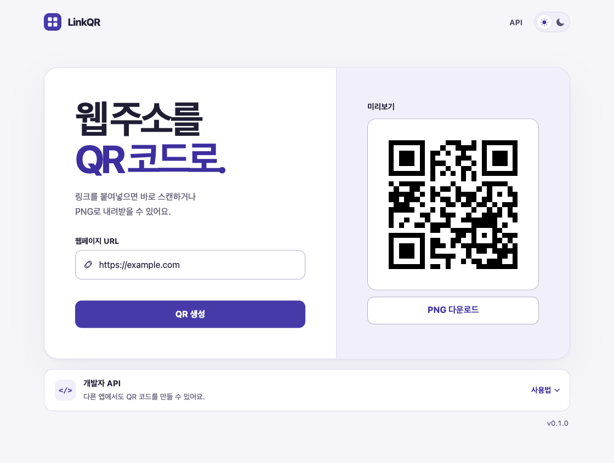

# LinkQR

웹페이지 URL을 정적 QR 코드로 만들어 PNG로 반환하는 자체 호스팅 도구입니다. 웹에서 미리 보고 내려받거나 HTTP API를 호출할 수 있습니다. 서버는 전달받은 URL을 방문하지 않으며 URL과 생성 이미지를 저장하지 않습니다.

**[라이브 데모 열기](https://qr.litanbid.net/)**

## 화면 미리보기

<picture>
  <source media="(prefers-color-scheme: dark)" srcset="docs/images/linkqr-dark.png">
  
</picture>

[라이트 화면](docs/images/linkqr-light.png) · [다크 화면](docs/images/linkqr-dark.png)

## 실행

Node.js 26 LTS의 최신 보안 패치를 사용하세요. 현재 프로젝트 기준 버전은 `.node-version`에 있습니다.

소스에서 실행하려면 다음 명령을 사용합니다.

```sh
npm ci
npm start
```

npm 공개 이후에는 아래처럼 설치해 실행할 수 있습니다.

```sh
npm install --global @litanbid/link-qr
link-qr serve
```

웹 화면은 기본으로 `http://127.0.0.1:3000`에서 열립니다. 직접 실행할 때는 `HOST`와 `PORT` 환경 변수로 바꿀 수 있습니다.

## Docker와 홈서버

공개 이미지로 설치하려면 [compose.release.yaml](compose.release.yaml)만 내려받아 실행합니다.

```sh
docker compose -f compose.release.yaml pull
docker compose -f compose.release.yaml up -d --wait
```

기본 이미지는 `ghcr.io/litanbid/link-qr:0.1.0`이며 `linux/amd64`와 `linux/arm64`를 제공합니다. 버전을 바꾸려면 `LINK_QR_VERSION`을 설정합니다. 새 정식 버전을 따라가려면 `LINK_QR_VERSION=latest`를 설정하고, 업데이트할 때 이미지를 다시 내려받아 스택을 재배포합니다. 소스에서 직접 빌드하려면 저장소를 내려받은 뒤 `docker compose up -d --build --wait`를 실행합니다.

Compose의 호스트 포트는 기본 `127.0.0.1:3000`입니다. 다른 서비스가 이미 사용한다면 `LINK_QR_PORT`를 변경하세요. 인터넷에서 연결하려면 전용 서브도메인에서 HTTPS 프록시로 이 포트에 연결하세요. 프록시가 별도 컨테이너라면 두 서비스를 공유 네트워크에 연결하고 내부의 `link-qr:3000`으로 전달할 수 있습니다.

웹 화면과 API는 로그인 없이 사용할 수 있습니다. 공개 운영 시 프록시에서 `POST /api/v1/qr`의 클라이언트별 호출 빈도를 제한하고, 요청 본문과 QR 응답의 로깅 및 캐시를 꺼 주세요. 프록시 뒤의 앱 포트는 내부에서만 연결하세요. 상태 확인은 `GET /healthz`를 사용합니다. [nginx 설정 예제](deploy/nginx.example.conf)에는 HTTPS와 IP당 분당 30회 제한을 함께 설정하는 방법이 있습니다.

## API

```sh
curl --fail --show-error --silent http://127.0.0.1:3000/api/v1/qr \
  -H 'Content-Type: application/json' \
  --data '{"url":"https://example.com/page?lang=ko#intro"}' \
  --output link-qr.png
```

API 응답 본문은 이미 PNG로 인코딩된 이미지 바이트입니다. cURL 예제의 `--output`은 호출한 쪽에서 바이트를 파일에 저장합니다. Node.js에서는 응답을 `Buffer`로 받아 메모리에서 바로 사용할 수 있습니다.

```js
const response = await fetch('http://127.0.0.1:3000/api/v1/qr', {
  method: 'POST',
  headers: { 'Content-Type': 'application/json' },
  body: JSON.stringify({ url: 'https://example.com' }),
});
if (!response.ok) throw new Error(`QR request failed: ${response.status}`);

const pngBytes = Buffer.from(await response.arrayBuffer());
```

입력은 UTF-8 기준 최대 1,024바이트의 절대 HTTP 또는 HTTPS URL입니다. 성공하면 512×512 PNG가 `image/png`로 반환됩니다. 오류 응답은 JSON이며 `code`와 `message`를 포함합니다. 요청 본문이 8 KiB를 초과하면 `413`, 동시 처리 한도를 넘기면 `503`을 반환합니다. 공개 프록시의 호출 제한을 초과하면 `429`를 반환하도록 설정하세요.

## 개발과 릴리스

`npm test`는 HTTP 응답 PNG를 디코딩해 입력 URL과 비교합니다. GitHub Actions는 PR과 `main`에서 API 및 npm 패키지와 Docker 빌드를 확인합니다.

첫 릴리스는 패키지를 검증한 뒤 소유 계정에서 `npm publish --access public`으로 게시합니다. 후속 게시 전에 npm Trusted Publishing에서 이 저장소의 `publish.yml`을 등록하고 직접 게시 권한을 설정합니다. 이후 `package.json` 버전과 일치하는 `v*` 태그를 GitHub에 푸시하면 CI가 검증한 버전을 npm 공식 레지스트리에 게시합니다. 홈서버 버전은 Compose에서 별도로 갱신합니다.

[MIT License](LICENSE)
